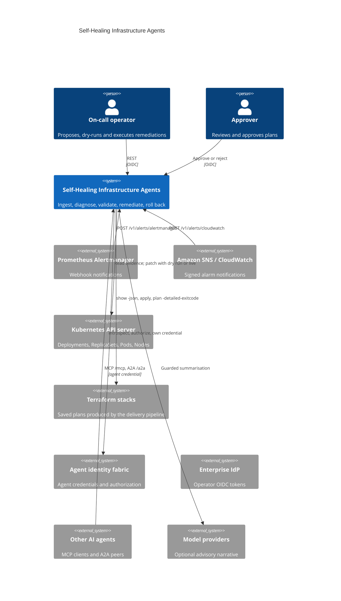
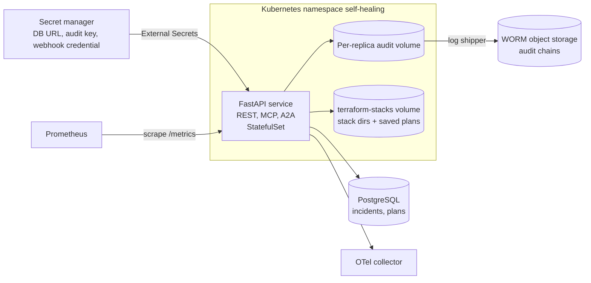
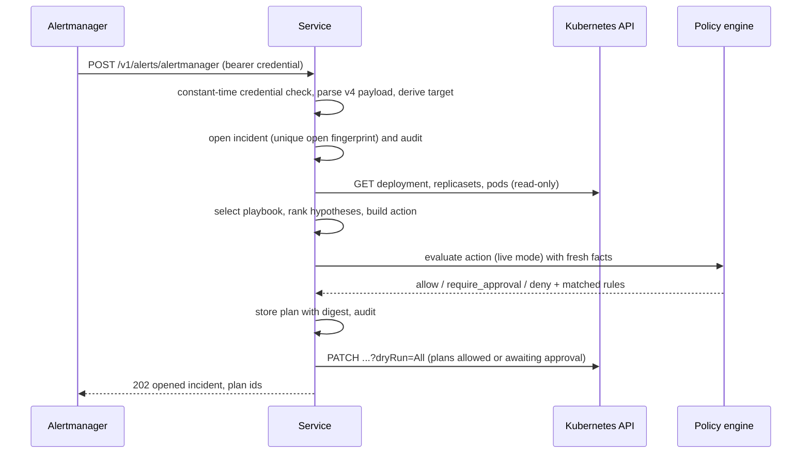
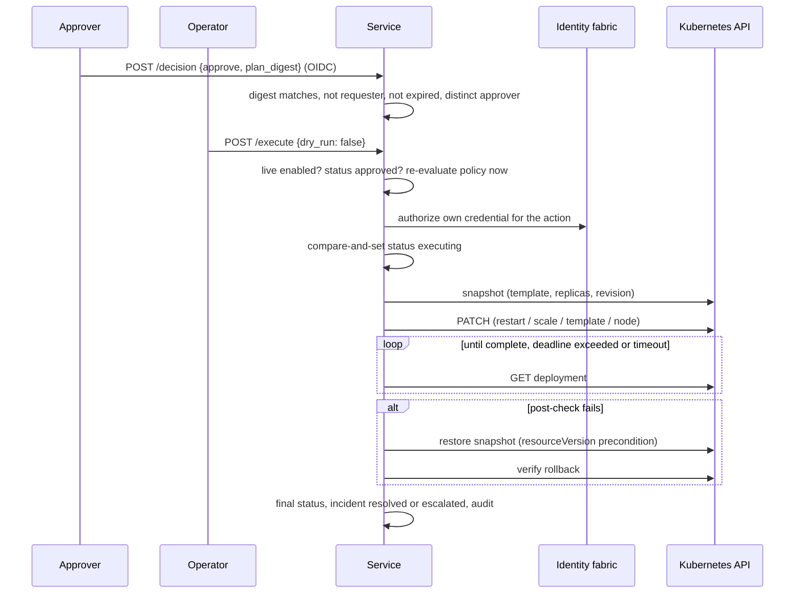
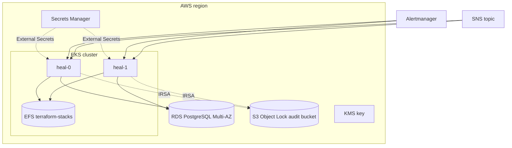

# Architecture

## Business problem

Most production incidents in cloud platforms are repeats of known failure
modes: a release that crash-loops, a workload that runs out of capacity, a
node that loses its disk, a managed database that fills up. The fix is
usually known and small, but it waits for a human to be paged, find the
context, and type commands under pressure. Fully autonomous remediation is
not acceptable either: a wrong `terraform apply` or a scale-to-zero can turn
an incident into an outage or data loss, and change management, audit and
segregation-of-duties obligations still apply.

This service closes the gap. It diagnoses alerts deterministically from
evidence, proposes the known fix, validates it against policy and change
windows, holds anything risky for a human approver, executes with a
post-check, and undoes its own change when the check fails. Dry run is the
default; every decision is in a signed audit chain.

## System context (C4 level 1)



## Containers (C4 level 2)



## Components (C4 level 3)

| Layer | Module | Responsibility |
|---|---|---|
| API | `api.webhooks`, `api.routes`, `api.mcp_tools`, `api.a2a`, `api.app` | HTTP contract, ingestion endpoints, MCP server, A2A, correlation IDs, body limit, error bodies, metrics, plan expiry sweep |
| Application | `application.incidents.IncidentService`, `application.remediation.RemediationService` | Correlate, diagnose, triage; propose, approve, execute, expire; audit every step |
| Ingestion | `ingestion.alertmanager`, `ingestion.cloudwatch`, `ingestion.targets` | Parse notifications into source-neutral alerts and remediation targets |
| Diagnosis | `diagnosis.playbooks`, `diagnosis.evidence`, `diagnosis.engine`, `diagnosis.narrator` | Playbook selection, read-only evidence, hypothesis ranking, guarded advisory narrative |
| Analysis | `analysis.terraform_plan` | Plan risk analysis, dependency graph, blast radius |
| Governance | `governance.governor`, `governance.change_windows` | Policy evaluation, invariants, risk, required approvals, change calendar |
| Remediation | `remediation.executor` | Snapshot, apply, post-check, rollback |
| Integrations | `integrations.kubernetes`, `integrations.terraform_cli`, `integrations.identity_fabric` | Kubernetes REST, Terraform CLI, identity fabric wire formats |
| Security | `security.sns`, `security.jwks`, `security.operators`, `security.callers` | SNS verification, JWT/JWKS, operator roles, agent authorization |
| Domain | `domain.models`, `domain.ports`, `domain.errors` | Aggregates, state machines, plan digest, ports |
| Infrastructure | `infrastructure.database` | SQLAlchemy Core repositories with compare-and-set updates |
| Runtime | `runtime.container` | Composition root |

## Sequences

### Alert to diagnosis to plan to dry run



### Approval, execution, post-check, rollback



### Terraform review and apply

```mermaid
sequenceDiagram
  participant C as Operator or pipeline
  participant H as Service
  participant T as Terraform CLI
  C->>H: POST /v1/remediations {terraform:apply, stack, plan_file}
  H->>T: terraform show -json plan_file
  H->>H: analyze: destroys, stateful, safety, blast radius, risk; digest
  H->>H: policy + invariants (stateful destroy denied, window, approval floor)
  Note over H: approvals bind to the plan digest
  C->>H: POST /execute (after approval)
  H->>T: terraform show -json again; digest must equal the approved one
  H->>T: terraform apply plan_file
  H->>T: terraform plan -detailed-exitcode (0 = converged)
  alt not converged and rollback_stack set
    H->>T: terraform plan -out=rollback-*.tfplan in last-known-good stack
    H->>H: analyze; apply only if non-destructive
  end
```

### SNS signature verification

```mermaid
sequenceDiagram
  participant S as Amazon SNS
  participant H as Service
  S->>H: POST /v1/alerts/cloudwatch (envelope)
  H->>H: topic on allow list? SignatureVersion == 2?
  H->>H: SigningCertURL https://sns.<region>.amazonaws.com/*.pem, region = topic region
  H->>H: timestamp within replay window
  H->>S: GET certificate (cached)
  H->>H: certificate valid now; RSA PKCS#1 v1.5 SHA-256 over canonical string
  alt SubscriptionConfirmation
    H->>S: GET SubscribeURL (same host checks)
  else Notification
    H->>H: parse CloudWatch alarm, ingest
  end
```

## Deployment view



Replicas spread across zones. The database guarantees one open incident per
fingerprint and compare-and-set plan transitions, so any replica can serve
any request. Each replica writes its own signed audit chain.

## Cloud reference implementation

| Concern | AWS (reference) | Azure | GCP |
|---|---|---|---|
| Runtime | EKS, IRSA service-account role | AKS, Workload Identity | GKE, Workload Identity |
| Database | RDS PostgreSQL Multi-AZ, KMS encrypted, TLS enforced | PostgreSQL Flexible Server, zone-redundant, private | Cloud SQL PostgreSQL regional, CMEK, private IP |
| Secrets | Secrets Manager with KMS | Key Vault (RBAC, purge protection) | Secret Manager |
| Audit storage | S3 Object Lock (compliance mode) | Immutable Blob storage | Retention-locked GCS bucket |
| Terraform stacks | EFS volume populated by the delivery pipeline with stack directories and saved plans | Azure Files share | Filestore share |
| Alarms | CloudWatch alarms to an SNS HTTPS subscription | Azure Monitor via Alertmanager | Cloud Monitoring via Alertmanager |

Terraform for all three is in `deployments/terraform/{aws,azure,gcp}`.
Cloud credentials that `terraform apply` needs come from the pod's workload
identity; the Terraform child process receives only an allow-listed
environment, never the service's own secrets.

## Data

| Store | Data | Classification | Retention |
|---|---|---|---|
| PostgreSQL `incidents` | Alerts (labels, annotations, payload digest), diagnosis, links to plans | CONFIDENTIAL (infrastructure topology) | 1 year online, then archive |
| PostgreSQL `remediation_plans` | Action, policy outcome, approvals, executions, snapshots | CONFIDENTIAL | 7 years (change records) |
| Audit chains | Who decided and did what, under which policy digest | CONFIDENTIAL | 7 years, WORM |
| Terraform stacks volume | Configuration and saved plans | CONFIDENTIAL; may contain sensitive values | Managed by the pipeline |

Bearer tokens, webhook credentials and SNS signatures are never persisted or
logged.

## Observability

- Metrics (`observability/metrics.py`): request latency histogram, alerts
  received, webhook rejections, incidents opened, diagnoses by playbook,
  policy decisions, approvals, remediations by action/mode/outcome,
  remediation duration, expired plans, Terraform analyses by risk, MCP and
  A2A calls.
- Traces: OpenTelemetry FastAPI instrumentation exported over OTLP when
  `HEAL_OTLP_ENDPOINT` is set; model calls observed by agentic-core.
- Logs: structured JSON with correlation IDs (`X-Correlation-ID`).
- Alerts: `configs/prometheus/alerts.yaml` (multi-window error budget burn,
  ingestion latency, rollback failure, rollback rate, deny spike, approval
  backlog, webhook rejections, replicas down).
- Dashboard: `configs/grafana/self-healing-infrastructure-agents.json`.

## CI/CD

`.github/workflows/ci.yml`: quality (Python 3.12 and 3.13: ruff, black,
mypy strict, bandit, contract drift, all test suites with a 90% coverage
gate), integration-postgres, deploy-artifacts (Helm lint and render,
required-values failure check, kubeconform, Terraform fmt and validate for
aws, azure and gcp, Trivy configuration scan), container (build, smoke test,
Trivy image scan, Syft SBOM, Grype gate), Semgrep.
`.github/workflows/release.yml` on `v*.*.*` tags: quality gate, image to GHCR
with build provenance attestation, Helm chart to GHCR OCI, GitHub release
with SBOM. The image carries a checksum-verified Terraform CLI.

## Cost and scalability

- The service is I/O bound: requests wait on the database, the Kubernetes
  API and Terraform. Two replicas cover availability; add replicas for alert
  storms, since ingestion is stateless apart from the database.
- Terraform applies are long-running and serialized per target by the
  one-active-plan-per-target rule; size `HEAL_TERRAFORM_TIMEOUT_SECONDS`
  (default 1800 s) to the slowest stack.
- Post-checks poll the API server every `HEAL_POLL_INTERVAL_SECONDS`
  (default 5 s) up to `HEAL_ROLLOUT_TIMEOUT_SECONDS` (default 600 s).
- The model narrator is optional and bounded to 400 output tokens per
  incident; disable it by leaving `HEAL_PROVIDERS_FILE` unset.
- Database growth is linear in incidents and plans; plan documents carry
  execution steps, so retention policy rather than compute drives cost.

## Acceptance criteria

| Criterion | Evidence |
|---|---|
| Forged, replayed or foreign-topic SNS messages are rejected | `tests/security/test_ingestion_security.py::TestCloudWatchSns` |
| A crash-looping recent release is diagnosed as a bad rollout and rolled back only after two approvals in production | `tests/e2e/test_http_lifecycle.py::test_bad_release_is_rolled_back_after_two_approvals` |
| A failed post-check restores the snapshot | `tests/unit/test_executor.py::TestKubernetesActions::test_restart_stuck_rolls_back_to_snapshot`, `tests/e2e/test_http_lifecycle.py::test_failed_post_check_rolls_back_and_escalates` |
| Stateful destroys can never be executed, even with approvals | `tests/unit/test_governor.py::TestTerraform::test_stateful_destroy_always_denied`, `tests/security/test_authorization_and_safety.py::TestRemediationSafety::test_stateful_destroy_cannot_be_approved_into_execution` |
| A plan swapped after approval is refused | `tests/unit/test_executor.py::TestTerraform::test_swapped_plan_is_refused` |
| Live execution is off unless enabled | `tests/security/test_authorization_and_safety.py::TestRemediationSafety::test_live_execution_disabled_by_default` |
| Kubernetes outage escalates instead of acting | `tests/chaos/test_dependency_failures.py::test_kubernetes_outage_escalates_instead_of_acting` |
| Audit failure blocks the action | `tests/chaos/test_dependency_failures.py::test_audit_failure_blocks_remediation` |
| No generated API input causes a 5xx | `tests/e2e/test_api_contract.py` |
